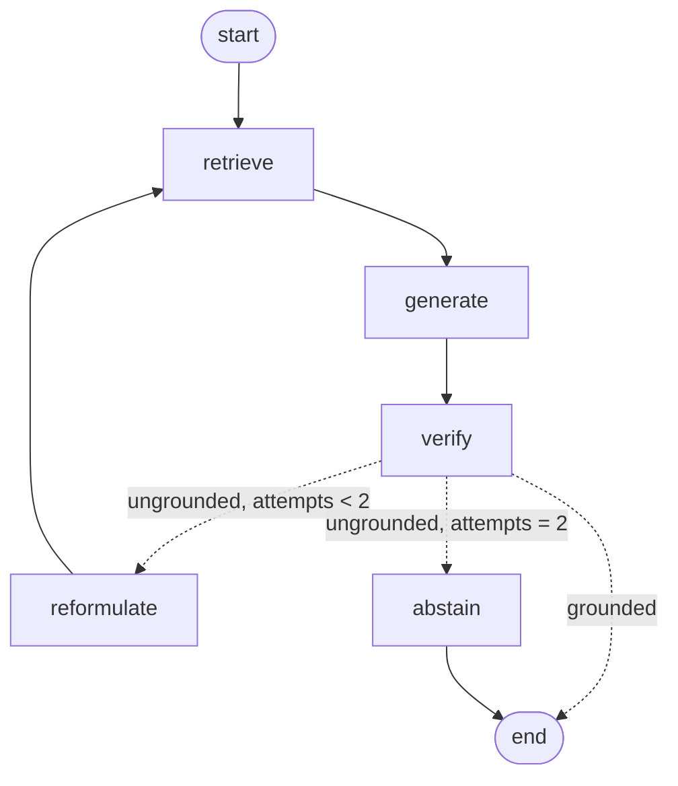

# Grounded RAG agent with bounded self-correction (LangGraph)

A retrieval agent that does not let a confident wrong answer through. It retrieves, drafts
an answer, then checks the draft against the retrieved text **in plain code**. If any error
code, version, number or citation can't be found verbatim in what was retrieved, the graph
rewrites the search and tries again, at most twice. Then it abstains with
*"Not supported by available sources"* instead of guessing.

Python · LangGraph · LangChain · OpenAI · ~295 lines of application code.

```bash
cp .env.example .env        # add OPENAI_API_KEY
uv run run.py               # runs the three example questions below
```

`uv run run.py "your question"` asks anything. `uv run pytest` runs the offline test suite,
which needs no API key.

## Graph



| Node | What it does | LLM? |
|---|---|---|
| `retrieve` | Hybrid search for the current query (the reformulated one if there is one, else the question). Chunks containing an identifier from the query verbatim come first, then cosine-similarity results from a local vector store, top 3 in total | embeddings only |
| `generate` | Answers the *original question* strictly from those chunks, citing `[kb-NN]` after each sentence | yes |
| `verify` | Deterministic grounding check; returns `grounded`, `ungrounded` or `fabricated` plus the reasons | **no** |
| `reformulate` | Rewrites the search using what the failed attempt revealed: which chunks came back and what the verifier couldn't find. Increments `attempts` | yes |
| `abstain` | Returns "Not supported by available sources", with the last search and the reasons | no |

The only branch is a real conditional edge on `verify` (`route_after_verify` in
[grounded_rag/graph.py](grounded_rag/graph.py)). No node contains routing logic. `fabricated` routes the
same way as `ungrounded`; the label is kept separately so you can tell the failures apart in logs.

**State** ([grounded_rag/state.py](grounded_rag/state.py)) is a typed `TypedDict`:
`query`, `reformulated_query`, `retrieved_chunks`, `draft_answer`, `verdict`, `unsupported_claims`, `attempts`.

**Checkpointer.** Every step is persisted to SQLite (`checkpoints.sqlite`), keyed by run ID:

```bash
uv run run.py --history run-1a2b3c4d   # every checkpoint: step, next node, verdict, search, drafts
uv run run.py --resume  run-1a2b3c4d   # continue a run that died mid-graph (e.g. API outage)
```

Rejected drafts aren't lost when the graph abstains. They stay in the checkpoint history,
so you can see exactly what the model tried to say.

## Why the verifier is deterministic

The verifier is the component that has to be right when the model is wrong. If it were an
LLM call, it would share the failure modes it's supposed to catch. A model that confuses
`E-4021` with `E-4012` while answering can make the same confusion while judging. Code
can't. [grounded_rag/verify.py](grounded_rag/verify.py) is 44 lines and enforces three rules:

1. Every citation `[kb-NN]` must point at a chunk that was actually retrieved. Otherwise the verdict is **fabricated**.
2. Every identifier (`E-4021`, `v2.4`) and number (`72`, `5,000`, `02:00`) in the answer must
   appear verbatim in the retrieved text. Otherwise the verdict is **ungrounded**.
3. The answer must cite at least one retrieved chunk. "I couldn't find it" with no citation is
   **ungrounded**, so it leads to a retry and then abstention, never to a silent pass.

Matching is boundary-aware: `E-402` doesn't match inside `E-4021`, and `15` doesn't match
inside `150`. A bare number may sit inside a code (`4021` in `E-4021`). In a corpus full of
adjacent identifiers, substring matching would wave exactly the wrong answers through.

It's also deterministic in the testing sense: same input, same verdict, every run. You can
unit-test it ([tests/test_graph.py](tests/test_graph.py) has 12 verifier cases) and explain a rejection
by pointing at a line. The trade-off is strictness. A correct answer that rephrases a number
("a quarter of an hour" for 15 minutes) fails, so the answer prompt tells the model to copy
figures exactly. It's the right trade for support, finance and ops content, where a wrong
number costs more than a retry.

## Why retrieval is hybrid: embeddings can't tell these codes apart

[grounded_rag/corpus.md](grounded_rag/corpus.md) is a 12-chunk error runbook for a fictional payments API.
It deliberately contains adjacent identifiers: `E-4012`, `E-4021`, `E-4102`, `E-4120`, `E-4201`,
`E-4202`, `E-4210`, plus API `v2.3` and `v2.4`.

The first version of this graph used vector search only. Measured with OpenAI
`text-embedding-3-small`, the E-4021 chunk ranks **4th even when the query is just "E-4021"**:

| Query | Top 5 by cosine similarity |
|---|---|
| `E-4021` | E-4201 (0.39), E-4210 (0.35), E-4012 (0.34), **E-4021 (0.33)**, E-4120 (0.30) |
| `error code E-4021` | E-4012 (0.42), E-4210 (0.39), E-4201 (0.38), **E-4021 (0.37)**, E-4202 (0.36) |
| `E-4021 billing sync failure troubleshooting steps` | E-4012 (0.69), E-4102 (0.64), E-4120 (0.61), E-4210 (0.45), **E-4021 (0.41)** |

With vector search alone, no reformulation could recover: every rewrite came back with the
same three wrong chunks, and the graph (correctly) abstained. So `retrieve` puts chunks that
contain an identifier from the query *verbatim* first, and fills the rest from the vector store.
Embeddings handle meaning; exact matching handles identifiers.

That's also why reformulation matters. Users rarely type codes in canonical form. Ask about
"error 4021" and there's no `E-4021` to match exactly, so the first search follows the words
"billing sync" to three wrong chunks. The verifier rejects the draft because `4021` isn't in
the retrieved text. The reformulation sees passages formatted as `E-4012`, `E-4102` and
`E-4120`, rewrites the code as `E-4021`, and the exact match finds it. A plain RAG pipeline
would have answered with the fix for E-4012.

## Example runs

Real output from `uv run run.py` (OpenAI `gpt-4.1-mini` and `text-embedding-3-small`). Each run
takes a different path through the graph. Example 2 took the same path in three runs out of three.

### 1. Grounded on the first try

```text
Q: What does error E-4210 mean, and should I issue the refund again?

── retrieve ────────────────────────────────────────────────────────
   retrieved_chunks:    kb-07 E-4210 (exact)  |  kb-05 E-4201 (0.62)  |  kb-06 E-4202 (0.58)

── generate ────────────────────────────────────────────────────────
   draft_answer:        Error E-4210 means "Refund delayed: card network timeout." This indicates
                        that the card network did not confirm the refund in time. No action is
                        needed because Acme Pay retries the refund automatically for up to 72 hours,
                        and the refund status stays "pending" until the network confirms [kb-07].
                        You should not issue the refund again, as the customer could be refunded
                        twice [kb-07].

── verify ──────────────────────────────────────────────────────────
   verdict:             GROUNDED
   unsupported_claims:  none

══ result [run-469fc793] verdict=grounded attempts=0
Error E-4210 means "Refund delayed: card network timeout." This indicates that the card network
did not confirm the refund in time. No action is needed because Acme Pay retries the refund
automatically for up to 72 hours, and the refund status stays "pending" until the network
confirms [kb-07]. You should not issue the refund again, as the customer could be refunded twice
[kb-07].
```

### 2. Grounded after reformulation

The draft is rejected because `4021` isn't in the retrieved text. The reformulated query
writes the code in canonical form, which matches kb-02 exactly. The model also invented a
description in the query ("invalid account credentials"). That's harmless: a search query is
allowed to be wrong, and only the answer is verified. Note that the final answer quietly
corrects the user: E-4021 is a ledger export error, not a billing sync one.

```text
Q: Our billing sync keeps failing with error 4021. How do we fix it?

── retrieve ────────────────────────────────────────────────────────
   retrieved_chunks:    kb-01 E-4012 (0.69)  |  kb-03 E-4102 (0.61)  |  kb-04 E-4120 (0.60)

── generate ────────────────────────────────────────────────────────
   draft_answer:        The context does not cover error 4021. It is missing the description and fix
                        instructions for error 4021.

── verify ──────────────────────────────────────────────────────────
   verdict:             UNGROUNDED
   unsupported_claims:  number 4021 not in retrieved context; answer cites no retrieved chunk

── reformulate ─────────────────────────────────────────────────────
   reformulated_query:  E-4021 · Billing sync failed: invalid account credentials
   attempts:            1

── retrieve ────────────────────────────────────────────────────────
   retrieved_chunks:    kb-02 E-4021 (exact)  |  kb-01 E-4012 (0.71)  |  kb-03 E-4102 (0.64)

── generate ────────────────────────────────────────────────────────
   draft_answer:        Error E-4021 means the ledger export was rejected due to a duplicate journal
                        reference, where a journal entry reused a reference that was already posted.
                        To fix this, you need to void the duplicate entry, then start a manual
                        export from Settings → Ledger → Export now. Note that a single export is
                        capped at 5,000 journal lines [kb-02].

── verify ──────────────────────────────────────────────────────────
   verdict:             GROUNDED
   unsupported_claims:  none

══ result [run-f6f1fe6d] verdict=grounded attempts=1
Error E-4021 means the ledger export was rejected due to a duplicate journal reference, where a
journal entry reused a reference that was already posted. To fix this, you need to void the
duplicate entry, then start a manual export from Settings → Ledger → Export now. Note that a
single export is capped at 5,000 journal lines [kb-02].
```

### 3. Abstention

E-4022 doesn't exist; E-4021, E-4201 and E-4202 do. Every pass retrieves an adjacent code,
every draft is rejected, and the graph says so instead of borrowing a neighbour's fix.

```text
Q: How do I resolve error E-4022 when issuing a refund?

── retrieve ────────────────────────────────────────────────────────
   retrieved_chunks:    kb-06 E-4202 (0.61)  |  kb-05 E-4201 (0.61)  |  kb-07 E-4210 (0.59)

── generate ────────────────────────────────────────────────────────
   draft_answer:        The context does not cover error E-4022 or how to resolve it. It only
                        provides information about errors E-4201, E-4202, and E-4210 related to
                        refunds.

── verify ──────────────────────────────────────────────────────────
   verdict:             UNGROUNDED
   unsupported_claims:  identifier E-4022 not in retrieved context; answer cites no retrieved chunk

── reformulate ─────────────────────────────────────────────────────
   reformulated_query:  E-4022 refund error resolution steps
   attempts:            1

── retrieve ────────────────────────────────────────────────────────
   retrieved_chunks:    kb-05 E-4201 (0.61)  |  kb-06 E-4202 (0.58)  |  kb-07 E-4210 (0.57)

── generate ────────────────────────────────────────────────────────
   draft_answer:        The context does not cover error E-4022 or how to resolve it. The passages
                        only provide information about errors E-4201, E-4202, and E-4210 related to
                        refunds.

── verify ──────────────────────────────────────────────────────────
   verdict:             UNGROUNDED
   unsupported_claims:  identifier E-4022 not in retrieved context; answer cites no retrieved chunk

── reformulate ─────────────────────────────────────────────────────
   reformulated_query:  E-4022 refund error resolution steps
   attempts:            2

── retrieve ────────────────────────────────────────────────────────
   retrieved_chunks:    kb-05 E-4201 (0.61)  |  kb-06 E-4202 (0.58)  |  kb-07 E-4210 (0.57)

── generate ────────────────────────────────────────────────────────
   draft_answer:        The context does not cover error E-4022 or how to resolve it. The provided
                        passages only describe errors E-4201, E-4202, and E-4210 related to refunds.
                        Information about error E-4022 is missing.

── verify ──────────────────────────────────────────────────────────
   verdict:             UNGROUNDED
   unsupported_claims:  identifier E-4022 not in retrieved context; answer cites no retrieved chunk

── abstain ─────────────────────────────────────────────────────────
   draft_answer:        Not supported by available sources. After 2 reformulations (last search:
                        "E-4022 refund error resolution steps"), no retrieved passage supports an
                        answer: identifier E-4022 not in retrieved context; answer cites no
                        retrieved chunk.

══ result [run-d7c90fbf] verdict=ungrounded attempts=2
Not supported by available sources. After 2 reformulations (last search: "E-4022 refund error
resolution steps"), no retrieved passage supports an answer: identifier E-4022 not in retrieved
context; answer cites no retrieved chunk.
```

## Tests

`uv run pytest` runs 27 tests offline, with no API key. They use a scripted LLM and
bag-of-words embeddings, which fall into the same adjacent-identifier trap as real
embeddings (a test asserts vector search alone misses the E-4021 chunk). Coverage:

- all three paths above, asserting the exact node sequence;
- exact identifier matches pinned ahead of vector results;
- every routing case of `route_after_verify`;
- verifier edge cases: adjacent codes, `6` vs `60`, `4021` inside `E-4021` vs not inside `E-4012`, version `v2.4` vs `v2.5`, fabricated citation, no citation, numbered lists;
- a transient API error retried by the node's `RetryPolicy`;
- a run that crashes mid-graph, then resumes from the SQLite checkpoint without re-running retrieval;
- rejected drafts still readable from checkpoint history after abstention.

## Layout

```
grounded_rag/state.py    typed state
grounded_rag/verify.py   deterministic grounding check
grounded_rag/graph.py    nodes, hybrid retrieval, conditional edge, compile with checkpointer
grounded_rag/corpus.md   12-chunk demo corpus
run.py                   CLI: prints every state transition; --history, --resume
tests/test_graph.py      offline tests
```

Swapping in a production store is one function. The graph only calls
`similarity_search_with_score`, so FAISS, Chroma or pgvector drop into `build_vector_store`.
